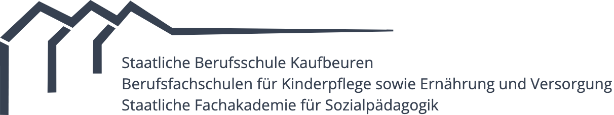

# SHK-Lernpakete

Interaktive Lernpakete (SCORM 1.2) für Anlagenmechaniker/-innen SHK. Jedes Paket läuft im Browser und lässt sich als ZIP in die ByCS-Lernplattform hochladen.

| Paket | Online | ZIP |
|---|---|---|
| Im Gleichgewicht – Hydraulischer Abgleich | https://bnbsinfo.github.io/shk-lernpakete/hydraulischer-abgleich/ | `docs/hydraulischer-abgleich_scorm12.zip` |

Aktualisieren: Quelle liegt neben diesem Ordner (`../hydraulischer-abgleich`), dann `./veroeffentlichen.sh`.
Ohne Lernplattform wird kein Ergebnis übertragen; der Fortschritt bleibt nur im Browser.
